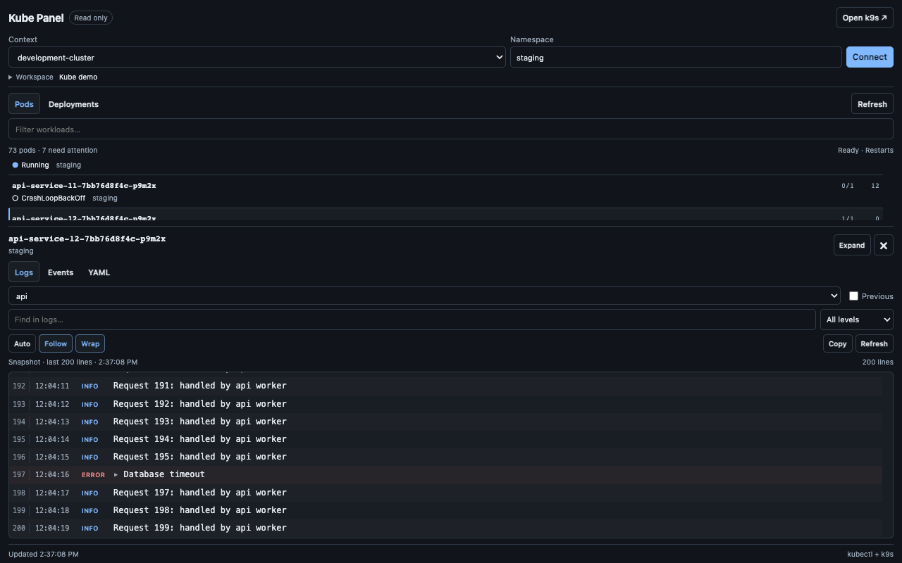

# Kube Panel

A build-free Orca plugin for inspecting Kubernetes beside your code.



- Browse pods and deployments, filter by name/namespace/status, and inspect readiness and restarts.
- Read the latest 200 log lines (including previous container instances), events, and resource YAML.
- Open and switch to a read-only k9s terminal with the chosen context, namespace, and resource view.
- Remember context and namespace for each selected Orca workspace.

## Install

```sh
orca plugin install bahachammakhi/kube-panel@v0.1.1
```

Review the requested access in Orca, then enable the plugin. Open **Kube Panel** from the right sidebar, or run `orca plugin open bahachammakhi.kube-panel`.

Requires Orca 1.4.254+, `kubectl`, a configured kubeconfig, and `k9s` for the launcher. This first release targets macOS and Linux local workspaces and has been tested on macOS. Kubernetes commands use your existing credentials and RBAC. macOS Homebrew binary locations are supported. On Linux, use `orca-ide` in the commands below when that is your Orca executable.

## Local development

```sh
git clone https://github.com/bahachammakhi/kube-panel.git
cd kube-panel
orca plugin check .
npm test
orca plugin dev load . --json
```

The load command reports an approval fingerprint. Review the access, then run the exact approval command it prints. Open **Kube Panel** in the right sidebar, or run:

```sh
orca plugin open local.kube-panel
```

Choose an Orca workspace, cluster context, and namespace, then **Connect**. Enter `*` for all namespaces. Namespace suggestions are optional; if your RBAC cannot list namespaces, type an allowed namespace directly. **Refresh** reloads the resource list and selected detail. Context and namespace edits disconnect the current view until you connect again.

The panel keeps its connection controls and filter visible while workloads scroll in a compact list. Selecting a resource opens a separate details pane immediately below the list, preserving your list position. **Expand** gives logs, events, or YAML the remaining panel space; **Split view** returns to the list and details together. Close details with **×** or **Escape**. The workspace destination selector is tucked into the expandable **Workspace** line.

The output inspector shows numbered log lines with timestamps and severity, search with highlighted matches, and level filters. JSON logs show their message first; expand a line to inspect all its fields. **Wrap** controls long lines, **Copy** copies the full output when the clipboard is available, and the inspector has its own **Refresh**. **Auto** optionally reloads the last 200 log lines every three seconds, pausing while the panel is hidden or previous-container logs are selected. **Follow** keeps the latest line visible; scrolling up pauses it. YAML has line numbers and key highlighting; events show type, reason, count, and time. Output is rendered as text, including messages containing HTML.

## Access and limits

The trusted Node worker executes only `kubectl config view`, `get`, and bounded `logs` reads using argument arrays, without a shell. Every cluster read names its context explicitly. It does not call `use-context` or change kubeconfig. Credentials are never returned to the panel. YAML and logs can contain application data; they remain in the local plugin UI.

Orca capabilities: `workspace:read` lists local terminal destinations; `terminal:send` opens a new k9s terminal; `storage:own` remembers selections. k9s starts with `--readonly`. The worker itself has the full local access associated with Orca's trusted-worker profile.

The plugin host API creates terminals in the background. The worker then uses the local Orca CLI's `terminal switch` command to reveal and select the new terminal. If that step fails, the panel reports that k9s started in the background and includes its terminal handle rather than claiming it is visible.

This version targets local kubeconfig and local Orca workspaces. Workload refresh is manual; logs are bounded snapshots with optional polling. Requests time out after 20 seconds, and resource lists are limited to 8 MiB of command output before being reduced to compact summaries. YAML display is limited to 512 KiB. Port forwarding, edits, restarts, remote workspace execution, and agent investigation are future features.

Unload development registration with `orca plugin dev unload .`. No cluster resources are changed by this plugin.

## License

MIT. This is an independent community plugin and is not affiliated with or endorsed by Orca or k9s.
